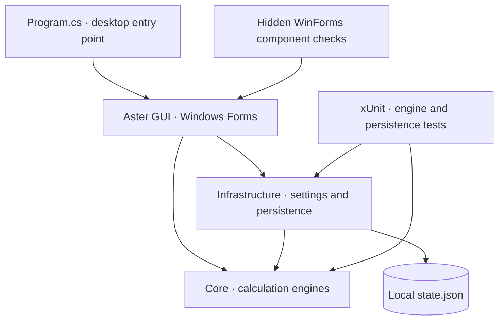

> For current download links and per-push release behavior, start with the [project README](../README.md) and [release guide](release-guide.md). The detailed reference below preserves the original interface and development material; rolling-preview references describe the earlier release convention.

<p align="center">
  
</p>

<a id="-aster--offline-windows-calculator"></a>

<div align="center" markdown="1">

# Aster — Offline Windows Calculator

<p align="center"><strong>Five calculator modes. One focused Windows workspace.</strong></p>

[](https://github.com/gcfernando/aster-windows-calculator/actions/workflows/repository-standards.yml) [](https://gcfernando.github.io/aster-windows-calculator/)

</div>

> **Start here:** [Get started](#guide-quick-start) · [Explore the interface](#guide-desktop-interface) · [Precision and limits](#guide-numeric-behavior-and-limits) · [Build and test](#guide-development-and-testing)

**Read online:** [Documentation website](https://gcfernando.github.io/aster-windows-calculator/) · [All guides](../documentation.md)

**Aster is an offline Windows calculator for everyday arithmetic, scientific expressions, programmer calculations, unit conversions and date arithmetic.** Its native Windows Forms interface keeps five modes, searchable history and reusable results in one workspace.

Use it to check a percentage, evaluate a formula, inspect an integer in four bases, repeat a unit conversion or compare dates. Built with **C# 14, .NET 10 and Windows Forms**, Aster runs calculations locally without an account or calculation service.

All features are fully enabled. There is no payment prompt, product key or activation service.

<p align="center">
  <a href="https://dotnet.microsoft.com/en-us/download/dotnet/10.0"></a>
  <a href="https://github.com/gcfernando/aster-windows-calculator/blob/main/Directory.Build.props"></a>
  <a href="https://github.com/gcfernando/aster-windows-calculator/blob/main/src/ModernCalculator.WinForms/ModernCalculator.WinForms.csproj"></a>
  <a href="https://github.com/gcfernando/aster-windows-calculator/blob/main/LICENSE"></a>
</p>

<p align="center">
  <a href="https://github.com/gcfernando/aster-windows-calculator/releases/download/latest/Aster-win-x64.zip">⬇️ Download for Windows x64</a> ·
  <a href="#readme-quick-start">🚀 Get started</a> ·
  <a href="#readme-gui">🖥️ Explore the interface</a> ·
  <a href="#readme-development">🧪 Build and test</a>
</p>

<details>
<summary><strong>📚 Table of contents</strong></summary>

- [📚 Documentation](#readme-documentation)
- [🚀 Quick start](#readme-quick-start)
- [🖥️ Desktop interface](#readme-gui)
- [📸 Screenshot gallery](#readme-gallery)
- [✨ Features and real-world use cases](#readme-features)
- [📖 Usage guide](#readme-usage)
- [⌨️ Keyboard shortcuts](#readme-shortcuts)
- [🔬 Numeric behavior and limits](#readme-numeric-behavior)
- [🔐 Configuration, privacy and local data](#readme-configuration)
- [🏗️ Architecture and technology](#readme-architecture)
- [🧪 Testing and development](#readme-development)
- [📦 Build a distributable Windows folder](#readme-publishing)
- [💡 Troubleshooting and FAQ](#readme-troubleshooting)
- [🤝 Contributing](#readme-contributing)
- [📄 License and resources](#readme-license)

</details>

## 🔎 Overview

Aster brings five local calculator modes to Windows users who need reusable results and explicit precision limits. Start with the mode table below, then use the [documentation index](../documentation.md) for the numeric, development and release references.

<a id="-features-and-real-world-use-cases"></a>

<a id="readme-features"></a>

## ✨ Features

Aster keeps several kinds of calculation in one local workspace. Choose the mode that matches the task and its precision model:

| Your task | Mode | Implemented tools |
| --- | --- | --- |
| Check a percentage, subtotal or decimal calculation | **Standard** | Up to **100 significant input digits**; exact bounded addition/subtraction/multiplication; percentages, square/root/reciprocal, repeated equals and calculator undo/redo. |
| Work through numerical formulas or scientific exercises | **Scientific** | Editable expressions, precedence, parentheses, powers, roots, factorials, constants, logarithms, trig/inverse trig, hyperbolic/inverse hyperbolic functions, DEG/RAD and `Ans`. |
| Inspect integer representations or debug bit operations | **Programmer** | Synchronized DEC/HEX/OCT/BIN; 8/16/32/64-bit signed/unsigned arithmetic; wrapping, bitwise operations, shifts, remainder and a paged bit editor. |
| Compare measurements or repeat a unit conversion | **Converter** | Twelve categories; searchable unit names/symbols/English aliases; live results; swap, Favorites and Recent; explicit history saving. |
| Compare dates or adjust a calendar date | **Dates** | Elapsed/inclusive counting, calendar breakdown, ISO input, inline calendars, Today/Swap/Reset, signed intervals and month-end clamping. |

The converter covers **length, mass, temperature, area, volume, time, speed, data storage, energy, power, pressure and angles**. US/Imperial volumes and decimal/binary data prefixes are distinguished.

Choose Aster for local numerical work that benefits from these modes and result reuse. Scientific and Converter use approximate binary64 arithmetic; Standard's higher decimal precision applies to Standard. Currency/live rates, symbolic algebra, complex numbers and time-zone calculations are outside the implemented feature set.

<a id="readme-gui"></a>

<a id="guide-desktop-interface"></a>

## 🖥️ Desktop interface

The desktop interface is implemented in [ModernCalculator.WinForms](https://github.com/gcfernando/aster-windows-calculator/tree/main/src/ModernCalculator.WinForms), uses the Core calculation engines and Infrastructure state store, and publishes as **`Aster.exe`**.

Launch it with the [Quick start command](#readme-quick-start), or run `Aster.exe` from a [published folder](#readme-publishing). A framework-dependent folder needs the **.NET 10 Desktop Runtime** on the destination computer; a self-contained folder includes its matching runtime. The optional `ASTER_DATA_DIRECTORY` setting selects a local profile directory; see [configuration and local data](#readme-configuration).

Enter and view calculations in the desktop app. The documented `dotnet` commands build, launch, test or publish it. The repository does not provide a terminal calculator, browser frontend or HTTP API.

### 🧭 Find your way around

1. **Choose a mode** across the top: Standard, Scientific, Programmer, Converter or Dates. Use on-screen controls, editable fields or the [keyboard shortcuts](#readme-shortcuts).
2. **Keep and reuse results.** Header buttons copy/paste for the active mode. **Ctrl+H** opens searchable history and session memory; **Use result** recalls a card into a compatible mode.
3. **Set your preferences.** Choose light, dark or system appearance, Automatic/Compact density, reduced hover motion, system high-contrast colors or always-on-top. Preferences changes apply with **Save**; Cancel, close or Escape discards the draft.
4. **Arrange the window.** Drag the brand or empty header space, resize at edges/corners and maximize/restore within the monitor's working area. Mode and preferences changes retain your chosen dimensions within each mode's minimum and the monitor bounds. History adjusts width without resetting height. Compact density sets preferred startup dimensions. Visible segments and explicit pages keep controls within the workspace.

History retains up to **200 calculations**. Search covers the entire journal, and previous/next controls traverse matching entries. Copy, delete or **Use result** acts on the current card. Clearing all history or memory through the drawer requires a second confirmation; closing the drawer, changing tabs or changing its collection cancels it. Each completed calculation creates a separate entry, including repeated equals in Standard and reevaluation in Scientific; a single Enter is routed once. History saving between sessions defaults to **off**.

Standard and Scientific share up to **20 decimal memory slots** for the session. Standard places memory above the keypad; Scientific places it below. **MA** opens all slots, **MS** stores a new slot, **MR** recalls the newest, **M+ / M−** updates it and **MC immediately clears memory**. Recalling exact Standard memory into Scientific can round to binary64 without changing the saved value.

Results are selectable and read-only. Long values fit, wrap and use explicit digit pages when needed. **Copy result** preserves the full stored value. Preferences → Numbers selects **3–15 significant display digits** for Scientific and Converter; display rounding does not change the engine's precision. Restore defaults is staged; clearing saved history requires confirmation followed by Save.

<a id="readme-gallery"></a>

### 📸 Screenshot gallery

<p align="center">
  <picture>
    <source media="(prefers-color-scheme: dark)" srcset="docs/images/scientific-dark.png">
    <source media="(prefers-color-scheme: light)" srcset="docs/images/scientific-light.png">
    
  </picture>
</p>

<p align="center"><em>Scientific mode: the preview follows your light or dark theme.</em><br><a href="https://gcfernando.github.io/aster-windows-calculator/docs/images/scientific-light.png">Light preview</a> · <a href="https://gcfernando.github.io/aster-windows-calculator/docs/images/scientific-dark.png">Dark preview</a></p>

| Standard · light | Programmer · dark |
| :---: | :---: |
| [](https://gcfernando.github.io/aster-windows-calculator/docs/images/standard-light.png) | [](https://gcfernando.github.io/aster-windows-calculator/docs/images/programmer-dark.png) |

| Converter · light | Dates · dark |
| :---: | :---: |
| [](https://gcfernando.github.io/aster-windows-calculator/docs/images/converter-light.png) | [](https://gcfernando.github.io/aster-windows-calculator/docs/images/dates-dark.png) |

Select a gallery image to view it at full size. These real repository assets are **hidden WinForms component snapshots** of the application's client layout, produced by the UI harness. They are interface previews, not desktop recordings or evidence of physical-input, window-manager or native DPI testing.

<a id="readme-quick-start"></a>

<a id="guide-quick-start"></a>

## 🚀 Quick start

### Download and run

1. Download **[Aster-win-x64.zip — latest main preview](https://github.com/gcfernando/aster-windows-calculator/releases/download/latest/Aster-win-x64.zip)**. [Release notes and SHA-256 checksum](https://github.com/gcfernando/aster-windows-calculator/releases/tag/latest) identify the published commit and passing build.
2. Install the **[.NET 10 Desktop Runtime for Windows x64](https://dotnet.microsoft.com/en-us/download/dotnet/10.0)** if it is not already installed. Choose **Desktop Runtime**, rather than the ASP.NET Core runtime.
3. Right-click the ZIP, select **Extract All**, then open **`Aster.exe`** in the extracted folder. Keep all extracted files together.

This fully enabled download is an **unsigned preview** built automatically after a push to `main` passes verification. It may have issues that automated tests cannot detect. Use a supported Windows x64 edition; see the [installation, update and rollback guide](release-guide.md). Updates are manual: close Aster and extract the new ZIP into a separate folder. Download the ZIP asset rather than GitHub's source-code archives.

If a new build is still running or fails its checks, use the previously published preview. Each successful verification run also provides an **Aster-win-x64** artifact on the [Actions page](https://github.com/gcfernando/aster-windows-calculator/actions/workflows/verify.yml), retained for 30 days; downloading Actions artifacts requires a GitHub login. The release download above is the permanent public link.

### Build from source

Build from source on **Windows** with the **[.NET 10 SDK](https://dotnet.microsoft.com/en-us/download/dotnet/10.0)** and **Git**. See Microsoft's [supported Windows versions and editions](https://learn.microsoft.com/en-us/dotnet/core/install/windows).

Run these commands in PowerShell; all commands after `cd` run from the repository root:

```powershell
git clone https://github.com/gcfernando/aster-windows-calculator.git
cd aster-windows-calculator
dotnet restore ModernCalculator.sln
dotnet build ModernCalculator.sln -c Release -m:1
dotnet run --project src/ModernCalculator.WinForms -c Release --no-build
```

**Expected startup:** Aster opens in a centered window. A fresh profile uses the light theme and Standard mode, with history collapsed. Enter `0.1 + 0.2` and press **Enter**: Standard returns exactly `0.3`. Use your regional decimal separator on the keypad.

[global.json](https://github.com/gcfernando/aster-windows-calculator/blob/main/global.json) requests SDK `10.0.100` with `latestFeature` roll-forward, allowing later installed .NET 10 feature bands. Application projects have **no third-party package dependencies**; only the xUnit test project declares NuGet package references. SDK/runtime installation and initial restore can need internet access; calculations work offline.

**Using Visual Studio?** Open [ModernCalculator.sln](https://github.com/gcfernando/aster-windows-calculator/blob/main/ModernCalculator.sln) in **Visual Studio 2026 (18+)** with the **.NET desktop development** workload. Set **ModernCalculator.WinForms** as the startup project and press **F5**. Core and Infrastructure are libraries. See Microsoft's [SDK/Visual Studio compatibility guide](https://learn.microsoft.com/en-us/dotnet/core/porting/versioning-sdk-msbuild-vs); Visual Studio 2022 does not officially support targeting .NET 10.

To run on another Windows computer, [publish a distributable folder](#readme-publishing).

## 📦 Prerequisites and installation

For the portable preview, use Windows x64 with the .NET 10 Desktop Runtime. Source builds need the .NET 10 SDK selected by [global.json](https://github.com/gcfernando/aster-windows-calculator/blob/main/global.json); Git and initial NuGet access are required for the clone and test-package restore. The [release guide](release-guide.md#install-and-first-run) covers extraction, updates and removal. Keep the complete published folder together.

<a id="-configuration-privacy-and-local-data"></a>

<a id="readme-configuration"></a>

<a id="guide-configuration-and-local-data"></a>

## ⚙️ Configuration and local data

Aster uses **Preferences** for everyday settings. No account, API key, database, `.env` file or background service is required.

| Data | Retention |
| --- | --- |
| Preferences and up to 20 favorite unit pairs | Saved to local JSON |
| Calculation history | Up to 200 entries in session; saving between sessions defaults to **off** |
| Memory slots | Up to 20, session only; never persisted |

The default file is `%LOCALAPPDATA%\AsterCalculator\state.json`. The optional **`ASTER_DATA_DIRECTORY`** environment variable overrides its parent directory. For an isolated local profile, set it before launch:

```powershell
$env:ASTER_DATA_DIRECTORY = Join-Path $PWD '.local\readme-profile'
dotnet run --project src/ModernCalculator.WinForms -c Release --no-build
```

The variable applies to processes started from that PowerShell session. Unset it with `Remove-Item Env:ASTER_DATA_DIRECTORY` to return subsequent launches to the default directory.

State uses a temporary file in the same directory followed by replacement. Missing data uses defaults; corrupt, locked or unreadable profiles produce a warning and use defaults. The loader bounds the bytes read from one open file. Save failures remain visible, and session settings continue to work. A save exceeding the **2 MiB** file limit preserves the previous file and asks you to reduce saved history before retrying.

New profiles use **schema version 1**; legacy profiles without a version remain readable. An unsupported schema is preserved and saving is refused, including when a newer application replaces the profile after startup. Use a compatible app version or a separate data directory to continue.

Disabling history persistence removes saved history on the next successful save while preserving the session list and favorites; calculations then avoid per-result profile writes. Multiple instances use **last writer wins** without merging histories. State is ordinary local JSON and is **not encrypted**. F1 → Support lets you review and copy local diagnostics; it excludes calculations, history, memory, usernames and profile paths, and nothing is sent automatically.

<a id="-usage-guide"></a>

<a id="readme-usage"></a>

## 💡 Usage

### 🧮 Standard and Scientific

Standard executes pending operations immediately: `2 + 3 × 4 =` produces **20**. Scientific applies precedence and produces **14**. Standard interprets `200 + 10 % =` as **220**; Scientific and Programmer interpret `%` as **remainder**.

In Scientific, enter an expression and press Enter:

| Expression | Expected behavior |
| --- | --- |
| `sqrt(144) + 2^3` | `20` |
| `sin(30) + logbase(81,3)` | Approximately `4.5` in DEG mode |
| `root(-32,5)` | `-2` |
| `2^3^2` | `512`; powers associate right to left |
| `asinh(2) + acosh(3) + atanh(0.5)` | Evaluates inverse hyperbolic functions |

Use explicit multiplication, such as `2*pi`. Dot-decimal locales separate arguments with commas; comma-decimal locales use semicolons, such as `logbase(81;3)`. Scientific literals accept a dot or the current decimal separator and exclude grouping separators.

Choose **Powers & logs**, **Trigonometry** or **Hyperbolic** to access visible function banks. Expressions remain editable after equals. Select an operand to apply a power, factorial or function to it; an explicit selection takes priority over continuing from the answer. Scientific keypad edits support **Ctrl+Z**. A keypad edit that would exceed the **2,048-character** limit is rejected without truncating the expression or changing its selection and Undo state. Editing an expression or changing DEG/RAD invalidates the old result until you evaluate again; `Ans` retains the last successful answer.

### 💻 Programmer

Select a base row or press **Alt+1–4** to edit Decimal, Hexadecimal, Octal or Binary. In **unsigned 8-bit** mode, decimal `255` is hex `FF`, octal `377` and binary `11111111`. Unsupported keypad digits are disabled, and incomplete input cannot copy a stale result.

**Keypad / Bit editor** changes the workspace. Paged, labeled bit ranges expose every bit without scrolling. Reused history/memory integers preserve their numeric value across display bases where representable.

### 🔄 Unit converter

Choose a category, then search each From/To group by name, symbol or an English alias such as `feet`, `meter` or `°C`. **Back / More**, arrows, Home/End and Page Up/Down reach every match. Enter in a search field chooses the first visible match on the current page.

The current unit is revealed when units are loaded or the layout becomes compact, provided it matches the active search. Resizing preserves your search text, and malformed Unicode search input is handled safely.

Results update as you type. Converter input accepts the current decimal separator and scientific notation, but not digit grouping. **Swap units** reverses the pair while keeping the input value unchanged. **Save pair** saves a favorite independently of history; **Save conversion**, or Enter in the value field, records a completed conversion. **Recent** restores its value and unit pair. Swap/save actions are disabled while browsing Favorites or Recent. The factor or temperature formula and precision information appear below the controls.

### 📅 Date calculator

**Days between dates** updates live from `YYYY-MM-DD` inputs, Today buttons or inline calendars. Identical dates mean zero elapsed days or one inclusive day; saving is explicit. Invalid input identifies the affected date field, and its accessibility description returns to format guidance once corrected.

**Adjust a date** applies signed years, months, weeks and days using Add or Subtract, while preserving the separate difference inputs. Calendars support keyboard navigation and explicit week paging in compact layouts. Only ISO date results can be reused as dates; day-count history entries remain descriptive.

<a id="readme-shortcuts"></a>

## ⌨️ Keyboard shortcuts

| Shortcut | Action |
| --- | --- |
| `Ctrl+1` … `Ctrl+5` | Switch Standard / Scientific / Programmer / Converter / Dates |
| `Enter` or `=` | Calculate in Standard, Scientific and Programmer |
| `Enter` in Converter / Dates | Save the current conversion / calculate and record the active date workflow |
| `Escape` | Clear a calculator, cancel an inline calendar or close a help/preferences dialog, depending on focus |
| `Delete` / `Backspace` | Clear entry / remove the last character; text fields retain native editing |
| `F9` | Change sign in Standard |
| `Ctrl+C` / `Ctrl+V` | Copy a text selection or full result / paste into the active field or calculator |
| `Ctrl+H` | Show or hide history and memory |
| `Ctrl+Z` / `Ctrl+Y` | Undo/redo Standard actions; editable fields retain native text editing |
| `Alt+1` … `Alt+4` | Choose the Programmer input base |
| `F1` | Open built-in help, including version/build on the Support topic |
| `Tab` / `Shift+Tab` / `Space` | Move focus / activate the focused control |

Preferences → Window also offers **Ctrl+Alt+1–5** for mode switching. Enter activates a focused action reached through keyboard navigation. Header copy/paste buttons operate on the active mode. Standard, Scientific and Programmer reject invalid numeric clipboard input before replacing their current value; Programmer uses the selected base. Standard and Scientific numeric paste parsing gives the current culture priority, including its decimal separator and native sign strings, with invariant dot-decimal notation as a fallback. Converter paste replaces the value field and shows validation if it cannot convert the input. Dates accepts ISO `YYYY-MM-DD` dates.

<a id="readme-numeric-behavior"></a>

<a id="guide-numeric-behavior-and-limits"></a>

## 🔬 Numeric behavior and limits

| Engine | Precision and contract |
| --- | --- |
| **Standard** | Bounded base-10 `BigDecimal` backed by `BigInteger`. Up to 100 significant input digits; addition, subtraction and multiplication are exact within bounds. Division and square root round to 100 significant digits, midpoint-to-even. |
| **Scientific** | Approximate binary64 arithmetic; about 15–17 decimal digits of representation, with operation-dependent rounding and cancellation. Real-number expressions; no symbolic algebra or complex numbers. |
| **Programmer** | Fixed-width integers modulo `2^width`. Signed decimal uses two's complement; other bases show raw bits. |
| **Converter** | Approximate binary64 factors and offsets with operation-dependent accuracy; temperature inputs are validated against absolute zero. |
| **Dates** | Date-only Gregorian arithmetic from year 0001 to 9999; no time-zone or daylight-saving calculations. |

Display rounding does not change the underlying calculation. Scientific and Converter copy/history use round-trip (`G17`) values. Standard memory and history retain full bounded decimal results, including results longer than the new-input limit.

[Read the complete numeric reference](numeric-behavior.md) for arithmetic bounds, input/state rules, domain errors, integer wrapping, calendar adjustment order and result-display behavior.

<a id="-architecture-and-technology"></a>

<a id="readme-architecture"></a>

<a id="️-architecture-and-technology"></a>

## 🏗️ Architecture

The desktop app calls shared engines in-process. Local persistence is handled separately from the calculator views:



| Project or setting | Responsibility |
| --- | --- |
| [ModernCalculator.Core](https://github.com/gcfernando/aster-windows-calculator/tree/main/src/ModernCalculator.Core) | `net10.0` engines, bounded `BigDecimal`/`BigInteger` arithmetic, expression grammar, integer operations, conversions, dates, memory and history; no Windows Forms references. |
| [ModernCalculator.Infrastructure](https://github.com/gcfernando/aster-windows-calculator/tree/main/src/ModernCalculator.Infrastructure) | Validated `AppSettings` and `System.Text.Json` state storage; references Core. |
| [ModernCalculator.WinForms](https://github.com/gcfernando/aster-windows-calculator/tree/main/src/ModernCalculator.WinForms) | `net10.0-windows` GUI executable, forms, mode views, custom controls, vector icons, themes and PerMonitorV2 configuration; references both libraries. |
| [ModernCalculator.Tests](https://github.com/gcfernando/aster-windows-calculator/tree/main/tests/ModernCalculator.Tests) | xUnit, Microsoft.NET.Test.Sdk and the Visual Studio test adapter. |
| [Directory.Build.props](https://github.com/gcfernando/aster-windows-calculator/blob/main/Directory.Build.props) | C# 14, nullable reference types, implicit usings, deterministic builds and warnings treated as errors. |

Mouse and keyboard routes share engine actions. Modes are constructed on first use and retained for the session, preserving their inputs when you switch. History formatting, drawer cards and result fitting reuse cached work. The scientific parser is a bounded recursive-descent parser, not a scripting engine.

### 📁 Repository structure

```text
ModernCalculator.sln
src/
  ModernCalculator.Core/            # Arithmetic, expressions, modes, units, memory, history
  ModernCalculator.Infrastructure/  # StateStore and AppSettings
  ModernCalculator.WinForms/        # Aster GUI: entry point, forms, views, controls, themes
tests/
  ModernCalculator.Tests/           # Engine and persistence regression tests
  ModernCalculator.UiChecks/        # Hidden controls, PNG snapshots and diagnostics
  ModernCalculator.DesktopAudit/    # Optional visible walkthrough with isolated state
tools/                             # Release verification, portable packaging and icon generation
.github/workflows/verify.yml       # Windows verification, ZIP artifact and main preview download
docs/
  development.md                   # Build, tests, walkthroughs and packaging
  numeric-behavior.md              # Engine precision and input/range contracts
  release-guide.md                 # Portable candidate, installation, updates and release gates
  images/                          # Existing logo and Aster GUI previews
```

Original vector icons and a bundled multi-resolution executable icon provide the branding. [Generate-Icon.ps1](https://github.com/gcfernando/aster-windows-calculator/blob/main/tools/Generate-Icon.ps1) regenerates the icon on Windows. The README logo is the existing icon's embedded 256-pixel PNG.

<a id="-testing-and-development"></a>

<a id="readme-development"></a>

<a id="guide-development-and-testing"></a>

## 🧪 Development and testing

Run the engine and persistence tests from the repository root:

```powershell
dotnet test tests/ModernCalculator.Tests -c Release --logger "console;verbosity=minimal"
```

For hidden WinForms component checks, build and run the separate harness:

```powershell
dotnet build tests/ModernCalculator.UiChecks -c Release -m:1
dotnet run --project tests/ModernCalculator.UiChecks -c Release --no-build -- artifacts/UiChecks
```

The engine suite checks calculation and persistence behavior, including independent definition-based anchors for all **78 converter units**, locale parsing and profile compatibility. The Windows-only component executable checks hidden controls, handlers, layout and snapshots using isolated state. Its PNGs and scale simulations do not establish physical-input, window-manager, screen-reader or real monitor-transition behavior.

The [Windows verification workflow](https://github.com/gcfernando/aster-windows-calculator/blob/main/.github/workflows/verify.yml) runs release-helper regressions and complete release verification on pushes, pull requests or manual dispatch. Successful runs package the verified application and retain the **Aster-win-x64** download for 30 days; reports are retained for 14 days. A passing push to the current `main` commit also updates the [latest preview release](https://github.com/gcfernando/aster-windows-calculator/releases/tag/latest). Pull requests, manual runs and older reruns cannot replace that release. Check the actual run and reports for current results.

Follow the [development guide](development.md) for TRX reports, the visible `ModernCalculator.DesktopAudit` walkthrough and specialized packaging prerequisites. The [component-check guide](../tests/ModernCalculator.UiChecks/README.md) explains filters, report fields and rendering limits. Use actual run reports rather than historical count defaults as evidence of a pass.

<a id="readme-publishing"></a>

## 📦 Build a distributable Windows folder

For a verified **Windows x64 portable candidate**, use Windows x64, **PowerShell 7** and the **.NET 10 SDK**. From the repository root:

```powershell
pwsh -NoProfile -File tools/Verify-Release.ps1
```

The helper runs all engine tests and the unfiltered hidden component harness, rejects failed/skipped/incomplete evidence, and records source, binary and report hashes. After success, inspect the reports under `artifacts/ReleaseVerification/<run>/`. Then pass that run's actual manifest path to the publisher, replacing `<run>` below:

```powershell
pwsh -NoProfile -File tools/Publish-Portable.ps1 -VerificationManifest artifacts/ReleaseVerification/<run>/manifest.json
```

The publisher accepts matching evidence, checks published application bytes, includes LICENSE, documentation and reports, and verifies the ZIP entries. It creates a new **unsigned, framework-dependent** candidate under `artifacts/ReleaseCandidates/<run>/`; it does not publish it. The destination computer needs the matching **[.NET 10 Desktop Runtime](https://dotnet.microsoft.com/en-us/download/dotnet/10.0)**. A hash manifest detects changes but does not authenticate the publisher.

Follow the [portable release guide](release-guide.md) for installation, update, rollback, removal and external release gates. Passing automated checks prepares a local candidate; clean-machine, physical-input, assistive-technology and real monitor-DPI checks still need separate evidence before unrestricted distribution.

### Other publish formats

For an ordinary **framework-dependent** development folder without the verification/package workflow:

```powershell
dotnet publish src/ModernCalculator.WinForms -c Release --self-contained false -o artifacts/publish/framework-dependent
```

Run `artifacts/publish/framework-dependent/Aster.exe` and keep the output folder together. The destination computer needs the Desktop Runtime matching the published architecture.

To bundle the runtime for **Windows x64** instead:

```powershell
dotnet publish src/ModernCalculator.WinForms -c Release -r win-x64 --self-contained true -o artifacts/publish/win-x64
```

This may download the matching runtime pack. Both commands create local publish folders. Keep the full folder together and include LICENSE. A bundled runtime needs servicing through a new application package; a framework-dependent build uses the compatible installed runtime. Check Microsoft's [.NET 10 supported Windows editions](https://github.com/dotnet/core/blob/main/release-notes/10.0/supported-os.md).

The specialized [audit packaging script](https://github.com/gcfernando/aster-windows-calculator/blob/main/tools/Package-Audited.ps1) remains available for its historical prepared-folder workflow, described in [specialized audit packaging](development.md#specialized-audit-packaging).

<a id="-troubleshooting-and-faq"></a>

<a id="readme-troubleshooting"></a>

## 🛠️ Troubleshooting and limitations

| Symptom | Check or action |
| --- | --- |
| Visual Studio says a class library cannot be started | Select **ModernCalculator.WinForms** as the startup project; Visual Studio can retain an older per-user selection. |
| The .NET 10 target is unavailable | Install the .NET 10 SDK, check `dotnet --list-sdks` and [global.json](https://github.com/gcfernando/aster-windows-calculator/blob/main/global.json), and use Visual Studio 2026 (18+) for IDE builds. |
| A published Aster asks for .NET | Install the matching **.NET 10 Desktop Runtime**, or use a self-contained publish folder. |
| A Scientific function rejects arguments | Match the locale's argument separator, use explicit multiplication and check the function's real-number domain. **F1** opens built-in examples. |
| An edited result cannot be copied | Evaluate again. Scientific expression/angle edits and incomplete Programmer input invalidate the previous copyable result. |
| History is missing after restarting | Saving history defaults to off. Enable Preferences → History and **Save**. Memory is always session-only. |
| Preferences cannot be saved | Check directory permissions or choose a writable `ASTER_DATA_DIRECTORY`; retry Save. Session settings remain active. |
| A profile uses an unsupported format | Keep the profile file. Reopen it with a compatible app version, or use a separate `ASTER_DATA_DIRECTORY`; Aster refuses to overwrite it. |
| A long result does not fit at once | Use the digit-page buttons or **Copy result** to obtain the full stored value. |

**Can I use Aster on macOS/Linux or in a terminal?** Aster targets Windows Forms on Windows. The Core/Infrastructure libraries target .NET 10, but the repository supplies no cross-platform GUI or calculator CLI.

**Does “100-digit” apply to every mode?** It describes Standard input and its decimal engine. Scientific and Converter use binary64. See [numeric behavior and limits](#readme-numeric-behavior).

**Do I need to connect online?** Calculation features work offline. Fetching the SDK, test packages or runtime packs can require a connection during setup or publishing.

**Why can the window have square corners?** Windows 11 receives a rounded-corner hint; Windows 10 uses a square fallback. Maximized or snapped windows can retain square corners.

<a id="readme-contributing"></a>

## 🤝 Contributing

Use the [issue tracker](https://github.com/gcfernando/aster-windows-calculator/issues) for reproducible problems and proposed improvements. F1 → Support provides local version/build/runtime and display diagnostics that you can review and copy. Include exact steps and sample input. The diagnostic text excludes calculations, history, memory, usernames and profile paths; nothing is sent automatically. Use sample data in screenshots.

Keep changes focused, preserve the numeric contracts and run the relevant engine tests and Windows component checks. Update documentation when behavior changes. Start with the [Core engines](https://github.com/gcfernando/aster-windows-calculator/tree/main/src/ModernCalculator.Core) and [mode views](https://github.com/gcfernando/aster-windows-calculator/tree/main/src/ModernCalculator.WinForms/Views) to trace how input reaches a calculation.

## 🔒 Security

Calculations, history and memory can contain private information. Review screenshots and copied diagnostics before sharing them. For a suspected vulnerability, use GitHub private vulnerability reporting if it is enabled on the repository; otherwise arrange a private reporting channel with the maintainer before sending sensitive details. Use the public issue tracker for ordinary reproducible bugs.

<a id="-license-and-resources"></a>

<a id="readme-license"></a>

## 📄 Support and license

Aster Calculator is licensed under the **[MIT License](https://github.com/gcfernando/aster-windows-calculator/blob/main/LICENSE)**. Copyright © 2026 Gehan Fernando.

- [GitHub repository](https://github.com/gcfernando/aster-windows-calculator)
- [Report a problem or suggest an improvement](https://github.com/gcfernando/aster-windows-calculator/issues)
- [Development and testing guide](development.md)
- [Numeric behavior reference](numeric-behavior.md)
- [Portable release guide](release-guide.md)
- [Windows component-check guide](../tests/ModernCalculator.UiChecks/README.md)
- [.NET 10 SDK and Desktop Runtime](https://dotnet.microsoft.com/en-us/download/dotnet/10.0)

<p align="center"><a href="#readme-quick-start">🚀 Build Aster</a> · <a href="#readme-gui">🖥️ Explore the interface</a> · <a href="#readme-configuration">🔐 Local data and preferences</a></p>

<a id="readme-documentation"></a>

## 📚 Documentation

| Start here | What it covers |
|---|---|
| [Quick start](#readme-quick-start) | Build and launch the Windows calculator. |
| [Modes and usage](#readme-usage) | Decimal arithmetic, scientific expressions, programmer bases, unit conversion and dates. |
| [Numeric behavior reference](numeric-behavior.md) | Precision, rounding, range limits and state/input contracts for each engine. |
| [Development and testing](development.md) | Restore/build, xUnit results, hidden component checks, manual walkthroughs and audit packaging assumptions. |
| [Component-check methodology](../tests/ModernCalculator.UiChecks/README.md) | Running/filtering the WinForms harness and interpreting reports, snapshots and DPI simulations. |
| [Portable release guide](release-guide.md) | Verify and package matching binaries; install, update, roll back and remove the app. |

[Documentation index](../documentation.md) collects these guides in one place.

## Repository maintenance

[Contributing](https://github.com/gcfernando/aster-windows-calculator/blob/main/CONTRIBUTING.md) · [Security policy](https://github.com/gcfernando/aster-windows-calculator/blob/main/SECURITY.md) · [Repository standards](https://github.com/gcfernando/aster-windows-calculator/blob/main/REPOSITORY_STANDARDS.md)
